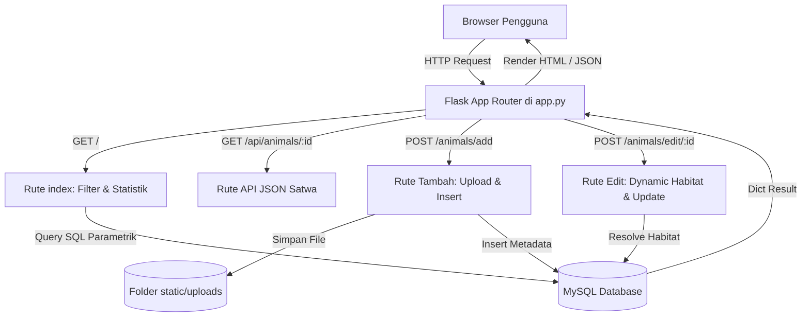

# 📗 Panduan Tugas Anggota 2: Backend Developer & Logic Engineer

## 👤 Identitas Peran
- **Nama Peran**: Backend Developer & Logic Engineer (Pengembang Server & Logika Bisnis)
- **Tanggung Jawab**: Membangun server web Flask, menangani request HTTP (GET, POST), membuat query SQL berparameter (anti SQL Injection), mengelola fitur upload file gambar, membuat algoritma ekstraksi metadata gambar, dan menyediakan endpoint API JSON.
- **File Kerja Utama**:
  1. [`app.py`](file:///c:/Users/ASUS/.gemini/antigravity/scratch/faunaguard/app.py)
  2. [`requirements.txt`](file:///c:/Users/ASUS/.gemini/antigravity/scratch/faunaguard/requirements.txt)

---

## ⚙️ 1. Pemahaman Logika Bisnis & Alur Controller

Aplikasi FaunaGuard menggunakan arsitektur **MVC (Model-View-Controller)**:
- **Model**: Database MySQL yang diakses melalui modul [`db.py`](file:///c:/Users/ASUS/.gemini/antigravity/scratch/faunaguard/db.py).
- **View**: Template HTML Jinja2 pada folder `templates/`.
- **Controller**: Fungsi-fungsi rute pada [`app.py`](file:///c:/Users/ASUS/.gemini/antigravity/scratch/faunaguard/app.py) yang memproses input user dan mengembalikan response.



---

## 🔑 2. Fitur Kunci & Kode yang Wajib Dipahami

### A. Pencegahan SQL Injection dengan Query Berparameter
Lihat baris [app.py:L74-L119](file:///c:/Users/ASUS/.gemini/antigravity/scratch/faunaguard/app.py#L74-L119):
```python
query = "SELECT ... FROM animals a JOIN ... WHERE 1=1"
params = []

if q:
    query += " AND (a.nama_lokal LIKE %s OR a.nama_ilmiah LIKE %s OR a.deskripsi LIKE %s)"
    params.extend([f"%{q}%", f"%{q}%", f"%{q}%"])

cursor.execute(query, params)
```
- **Poin Penting**: Jangan pernah menggabungkan string langsung seperti `f"WHERE nama = '{q}'"`. Penggunaan placeholder `%s` dan list `params` memastikan input disanitasi oleh PyMySQL sehingga aman dari serangan **SQL Injection**.

### B. Penanganan Upload File Gambar yang Aman
Lihat baris [app.py:L14-L24](file:///c:/Users/ASUS/.gemini/antigravity/scratch/faunaguard/app.py#L14-L24) dan [app.py:L311-L321](file:///c:/Users/ASUS/.gemini/antigravity/scratch/faunaguard/app.py#L311-L321):
- **Limit Ukuran File**: Dibatasi maksimal 16MB via `app.config['MAX_CONTENT_LENGTH'] = 16 * 1024 * 1024`.
- **Whitelist Ekstensi**: Hanya mengizinkan `{'png', 'jpg', 'jpeg', 'webp', 'gif'}` via fungsi `allowed_file()`.
- **Pencegahan Nama Bentrok & Directory Traversal**: Menggunakan `secure_filename()` dari Werkzeug digabungkan dengan awalan acak `uuid.uuid4().hex[:8]`, menghasilkan nama file unik seperti `/static/uploads/a1b2c3d4_foto.jpg`.

### C. Algoritma Cerdas: Ekstraksi Otomatis Gambar dari Link Artikel Web
Lihat baris [app.py:L26-L79](file:///c:/Users/ASUS/.gemini/antigravity/scratch/faunaguard/app.py#L26-L79):
- **Masalah Pengguna**: Seringkali pengguna menyalin link halaman artikel berita (misal: *https://jurnalflores.co.id/.../artikel.html*), padahal tag `` hanya bisa menampilkan file gambar.
- **Solusi Cerdas**: Fungsi `extract_direct_image_url(url)` melakukan HTTP request ringan dengan header `User-Agent` browser, lalu memindai metadata HTML untuk tag:
  - `<meta property="og:image" content="...">`
  - `<meta name="twitter:image" content="...">`
- Hasilnya, sistem secara otomatis menemukan tautan file gambar asli tanpa membuat pengguna bingung.

### D. Resolusi Kawasan Habitat Dinamis pada Rute Edit
Lihat baris [app.py:L386-L417](file:///c:/Users/ASUS/.gemini/antigravity/scratch/faunaguard/app.py#L386-L417):
- Saat pengguna mengetik nama habitat manual di form edit:
  1. Sistem mengecek apakah nama habitat sudah ada di tabel `habitats`.
  2. Jika sudah ada, sistem menggunakan ID tersebut dan memperbarui lokasi/ekosistemnya jika ada perubahan.
  3. Jika belum ada (habitat baru), sistem melakukan `INSERT INTO habitats ...` dan mengambil ID baru via `cursor.lastrowid`, lalu menghubungkannya ke satwa tersebut.

### E. Penanganan Error Anggun (*Graceful Degradation*)
Lihat baris [app.py:L82-L99](file:///c:/Users/ASUS/.gemini/antigravity/scratch/faunaguard/app.py#L82-L99):
- Menggunakan dekorator `@app.errorhandler(Exception)`.
- Jika server MySQL belum dinyalakan atau database belum diimpor, aplikasi tidak akan *crash* dengan halaman error hitam-putih bawaan Python, melainkan menyajikan halaman edukatif [`templates/setup_notice.html`](file:///c:/Users/ASUS/.gemini/antigravity/scratch/faunaguard/templates/setup_notice.html) lengkap dengan instruksi impor file SQL.

---

## 🎤 3. Simulasi Pertanyaan Dosen & Kunci Jawaban (Q&A)

### Q1: Bagaimana cara Anda mencegah pengguna mengunggah file berbahaya (misal: script PHP atau virus)?
> **Jawaban**:  
> "Kami menerapkan validasi berlapis: Pertama, fungsi `allowed_file()` memverifikasi ekstensi file hanya untuk format gambar yang aman (PNG, JPG, JPEG, WEBP, GIF). Kedua, fungsi `secure_filename()` membersihkan karakter berbahaya untuk mencegah *path traversal*. Ketiga, file disimpan di direktori terisolasi `static/uploads/` yang hanya disajikan sebagai aset statis oleh server Flask, bukan dieksekusi sebagai script."

### Q2: Mengapa rute `/api/animals/<int:animal_id>` dibuat terpisah dari rute HTML biasa?
> **Jawaban**:  
> "Rute tersebut berfungsi sebagai **RESTful API endpoint** yang mengembalikan data dalam format JSON (`jsonify(animal)`). Tujuannya agar antarmuka web di sisi klien dapat memuat data detail satwa secara asinkron (*AJAX / Fetch API*) ke dalam modal pop-up tanpa perlu memuat ulang (*reload*) seluruh halaman web."

### Q3: Apa yang terjadi jika pengguna memasukkan input pencarian dengan tanda petik atau karakter aneh?
> **Jawaban**:  
> "Aplikasi kami 100% aman karena tidak menggunakan konkatenasi string SQL mentah. Semua parameter pencarian dikirimkan melalui fitur *Parameterized Queries* PyMySQL (`cursor.execute(query, params)`). Karakter petik otomatis di-escape oleh driver database sehingga diperlakukan murni sebagai teks biasa, bukan kode executable SQL."
