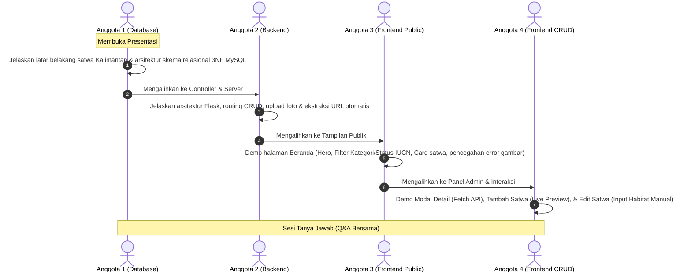

# 📋 Pembagian Tugas & Panduan Pembelajaran Proyek FaunaGuard (4 Anggota)

Selamat datang di modul dokumentasi tim proyek **FaunaGuard (Suaka Informasi & Edukasi Konservasi Satwa Dilindungi Kalimantan)**. Dokumen ini dirancang khusus untuk membagi tanggung jawab 4 orang anggota tim secara adil, proporsional, dan terstruktur sesuai standar industri perangkat lunak (*Software Engineering*).

Setiap anggota memiliki **fokus materi khusus**, **daftar file yang dikuasai**, serta **panduan tanya jawab (Q&A) ujian/sidang**.

---

## 👥 Matriks Pembagian Peran Tim (4 Orang)

```
                                  ┌─────────────────────────────┐
                                  │      PROYEK FAUNAGUARD      │
                                  └──────────────┬──────────────┘
                                                 │
        ┌───────────────────┬────────────────────┴───────────────────┬───────────────────┐
        ▼                   ▼                                        ▼                   ▼
┌───────────────┐   ┌───────────────┐                        ┌───────────────┐   ┌───────────────┐
│   ANGGOTA 1   │   │   ANGGOTA 2   │                        │   ANGGOTA 3   │   │   ANGGOTA 4   │
│Database & Data│   │Backend & Logic│                        │ Frontend UI & │   │ Frontend CRUD │
│   Architect   │   │   Engineer    │                        │ Public Portal │   │ & Interaksi JS│
└───────────────┘   └───────────────┘                        └───────────────┘   └───────────────┘
```

| No | Peran / Role | Anggota | Fokus Utama | File yang Dikuasai |
|---|---|---|---|---|
| **1** | **Database Engineer & Data Architect** | Anggota 1 | Perancangan Database Relasional (3NF), DDL, Integritas Relasi (Foreign Keys), Indexing, dan Modul Koneksi PyMySQL. | `database/faunaguard_schema.sql`<br>`db.py`<br>`.env` |
| **2** | **Backend Developer & Logic Engineer** | Anggota 2 | Arsitektur Server Flask, Routing, Controller CRUD, Penanganan Upload File Gambar, Ekstraksi Metadata URL, dan Filter Pencarian. | `app.py`<br>`requirements.txt` |
| **3** | **Frontend Developer (UI/UX & Public Portal)** | Anggota 3 | Desain Tema Hutan Borneo, Master Layout, Halaman Beranda (Katalog Satwa), Kartu Edukasi, Statistik Satwa, dan Aset Cadangan SVG. | `templates/base.html`<br>`templates/index.html`<br>`templates/setup_notice.html`<br>`static/css/style.css`<br>`static/img/placeholder.svg` |
| **4** | **Frontend Developer (CRUD Panel & Interaktivitas JS)** | Anggota 4 | Halaman Tabel Kelola Data Admin, Form Tambah & Edit Satwa, Live Image Preview, Input Kawasan Habitat Manual, dan Modal Pop-up Asinkron (Fetch API). | `templates/manage.html`<br>`templates/add_animal.html`<br>`templates/edit_animal.html`<br>`static/js/main.js` |

---

## 📂 Struktur Modul Pembelajaran per Anggota

Silakan buka dan pelajari dokumen spesifik masing-masing di dalam folder ini:

1. 📘 [**01_database_engineer.md**](file:///c:/Users/ASUS/.gemini/antigravity/scratch/faunaguard/pembagian_tugas/01_database_engineer.md)  
   *Panduan Anggota 1*: Skema tabel MySQL, Entity Relationship, Normalisasi 3NF, Foreign Key Constraints, Indeks, Seeder satwa Kalimantan, dan abstraksi `db.py`.
2. 📗 [**02_backend_developer.md**](file:///c:/Users/ASUS/.gemini/antigravity/scratch/faunaguard/pembagian_tugas/02_backend_developer.md)  
   *Panduan Anggota 2*: Alur kerja framework Flask, penanganan request GET/POST, algoritma ekstraksi gambar cerdas dari web, validasi upload file aman, query SQL berparameter (pencegahan SQL Injection).
3. 📙 [**03_frontend_ui_ux.md**](file:///c:/Users/ASUS/.gemini/antigravity/scratch/faunaguard/pembagian_tugas/03_frontend_ui_ux.md)  
   *Panduan Anggota 3*: Sistem desain visual Hutan Tropis Borneo, layout responsif Bootstrap 5 + Vanilla CSS tokens, templating engine Jinja2, banner edukasi, dan penanganan gambar anti-blokir (`no-referrer`).
4. 📕 [**04_frontend_crud_interaktif.md**](file:///c:/Users/ASUS/.gemini/antigravity/scratch/faunaguard/pembagian_tugas/04_frontend_crud_interaktif.md)  
   *Panduan Anggota 4*: Pengelolaan form Create & Update, fitur input Kawasan Habitat manual + datalist pintar, pratinjau instan gambar (live preview), dan pemuatan detail satwa asinkron via Vanilla JavaScript (`fetch` async/await).

---

## 🎯 Panduan Skenario Presentasi / Demo Kelompok (Urutan Tampil)

Agar presentasi kelompok terlihat kompak dan profesional di hadapan dosen atau audiens, gunakan urutan penyampaian berikut:



1. **Menit 00:00 - 03:00 (Anggota 1)**: Membuka presentasi, menjelaskan perancangan database relasional di MySQL Workbench, struktur 4 tabel ternormalisasi, dan skrip koneksi database aman.
2. **Menit 03:00 - 06:00 (Anggota 2)**: Menjelaskan arsitektur backend Python Flask, bagaimana request diproses, alur pengamanan upload file, dan logika query dinamis.
3. **Menit 06:00 - 09:00 (Anggota 3)**: Melakukan demo tampilan antarmuka publik, filosofi palet warna hutan Borneo, sistem filter pencarian instan, dan kartu profil satwa.
4. **Menit 09:00 - 12:00 (Anggota 4)**: Mendemonstrasikan panel CRUD, fitur unggah file foto dari komputer dengan live preview, serta fitur edit kawasan habitat manual.
5. **Menit 12:00 - Selesai**: Menjawab pertanyaan penguji/dosen sesuai panduan Q&A pada masing-masing dokumen.
